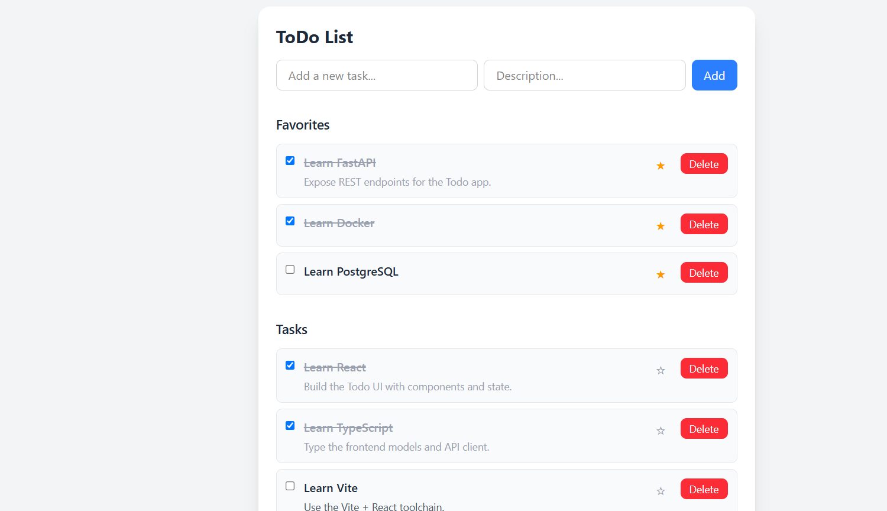

# 📚 Technical Test: Todo App



## ✨ Features
- Create tasks with a title and a description.
- Mark tasks as completed / pending.
- Delete tasks.
- Mark / unmark tasks as favorite. Favorites are shown in their own section.
- Task list is refreshed automatically on page load and after every action (create, complete, favorite, delete).
- Persistence in a JSON file (**backend/app/todos.json**).

---

## 🛠️ Tech Stack
- **Backend:**	Python, FastAPI, Pydantic, Uvicorn
- **Frontend:** Vite, React, TypeScript, Tailwind
- **Storage:**	JSON file
- **Testing:**	pytest + FastAPI TestClient

---

## 🚀 Getting Started
### Prerequisites
   - Python 3.10+
   - Node.js 18+ and npm
### How to run the project
1. Create a virtual environment and install the dependencies for the backend:

   ```bash
   cd backend
   python -m venv .venv
   source .venv/bin/activate  # On Windows use `.venv\Scripts\activate`
   pip install -r requirements.txt
   ```

2. Install the dependencies for the frontend:

   ```bash
   cd frontend
   npm install
   ```

3. Run the application:

   ```bash
   npm run dev
   ```
   This single command starts both servers using concurrently:
   - Frontend	http://localhost:5173
   - Backend	http://localhost:8000


4. Open your browser and navigate to `http://localhost:5173` to see the application.

## 📖 Usage Guide
- **Start:** You will see all your tasks. The initial data lives in backend/app/todos.json and you can edit it manually; reload the page to see the changes (no backend restart needed).
- **Create a task:** Type a title (required) and an optional description, then click the Add button.
- **Task status:** Click the checkbox to mark a task as completed or pending. Completed tasks are shown crossed out.
- **Favorites:** Click the star to add or remove a task from your favorites. Favorite tasks appear in a separate Favorites section above the rest.
- **Delete:** Click the Delete button on a task to remove it permanently.

---

### Tests

The backend is covered by pytest tests. With the virtual environment activated:

```bash
cd backend
pytest -v     # verbose: one line per test
```
---

### Task model

```json
{
  "id": 1,
  "title": "Learn FastAPI",
  "description": "Expose REST endpoints for the Todo app.",
  "completed": false,
  "favorite": true
}
```
*Only title is required when creating a task. The id is generated automatically by the backend.*

---

## 📂 Project Structure
```text
TodoApp/
├── backend/
│   ├── app/
│   │   ├── routers/
│   │   │   └── todos.py          # REST endpoints under /todos
│   │   ├── main.py               # FastAPI app, CORS and router registration
│   │   ├── models.py             # Pydantic models
│   │   ├── repository.py         # TodoRepository: JSON file persistence (repository pattern)
│   │   └── todos.json            # Tasks storage
│   ├── tests/
│   │   ├── __init__.py
│   │   ├── conftest.py           # Temporary JSON file and TestClient
│   │   ├── test_repository.py    # Unit tests for TodoRepository
│   │   └── test_todos_api.py     # Endpoint tests for /todos
│   ├── pytest.ini                # pytest configuration
│   └── requirements.txt          # Dependencies
├── frontend/
│   ├── src/
│   │   ├── api/
│   │   │   ├── todo.ts           # HTTP client for the backend API
│   │   │   └── todo.test.ts      # Tests for the HTTP client
│   │   ├── components/
│   │   │   ├── TodoForm.tsx      # Form to create a task
│   │   │   ├── TodoItem.tsx      # Single task (checkbox, favorite and delete actions)
│   │   │   └── TodoList.tsx      # List of tasks with empty state
│   │   ├── test/
│   │   │   └── setup.ts          # Vitest setup (jest-dom matchers, cleanup)
│   │   ├── types/
│   │   │   └── todo.d.ts         # TypeScript types (Todo, payloads)
│   │   ├── App.test.tsx          # Tests for the main flows of the UI
│   │   ├── App.tsx               # Main component: state, API calls, Favorites/Tasks sections
│   │   ├── index.css             # Tailwind CSS import
│   │   └── main.tsx              # React entry point
│   ├── index.html
│   └── package.json              # Dependencies and scripts (`npm run dev`, `npm test`...)
├── .gitignore
├── INSTRUCTIONS.md              # Objectives and guide of the technical test
└── README.md
```

---

## 🧩 Design Notes
- **Backend layering:** routers (HTTP layer) → repository (data access) → models (validation). 
Swapping the JSON file for a real database would only require changing repository.py.
- **Frontend layering:** api/ isolates all fetch calls, components/ are presentational, and App.tsx owns the state and re-fetches the list after every change so the UI always reflects what is stored in the backend.
